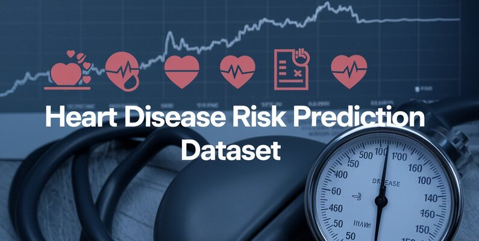
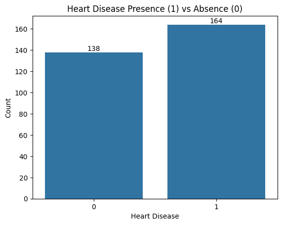
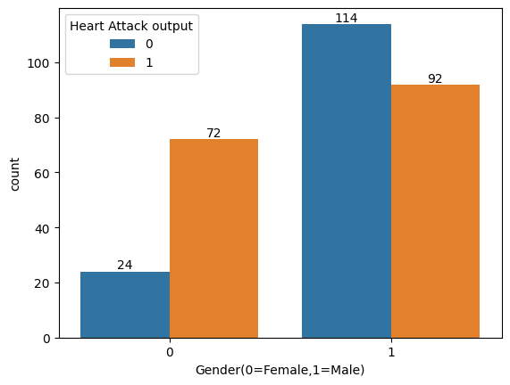
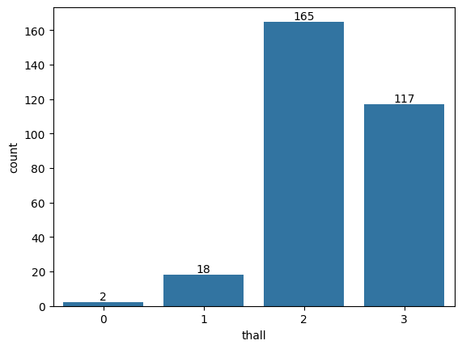
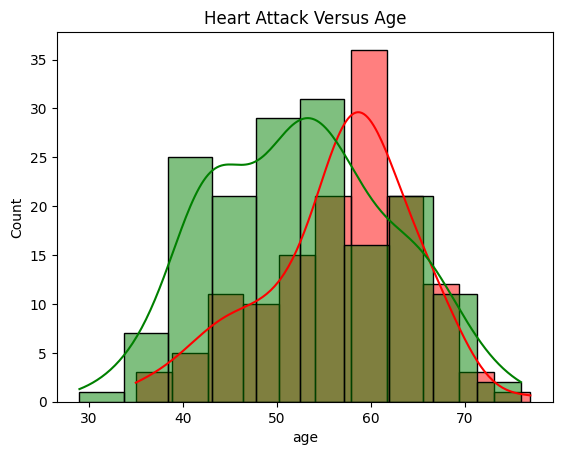
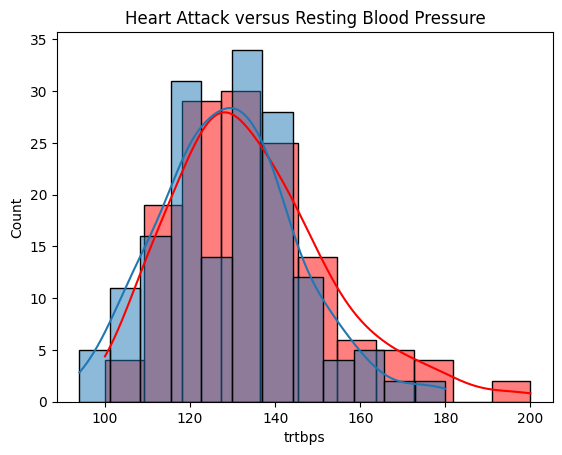

# 🫀 Heart Attack Prediction using Machine Learning

## ❤️ Why Early Detection Matters

- Cardiovascular diseases are the leading cause of death globally, responsible for **32% of all deaths**.
- Predictive models can flag high-risk individuals **before symptoms appear**, enabling timely intervention and clinical decision support.

---

## 📊 Dataset Overview

Structured tabular dataset with key patient features:

- **Numerical variables**: age, resting blood pressure, cholesterol, chest pain type, etc.
- **Target**: binary classification (presence or absence of heart attack)

---

## 🧠 Workflow Summary

### 🔹 Data Cleaning
- Checked for missing values
- Verified variable types
- Handled duplicates
- Detected outliers using z-scores

### 🔹 Exploratory Data Analysis
- Visualized class balance (heart attack vs. no heart attack)
- Categorized variables into discrete and continuous
- Used histograms and distribution curves to assess skewness

### 🔹 Feature Engineering
- Applied normalization to ensure equal feature contribution during model learning

### 🔹 Feature Selection
- Retained all features due to correlation with the target
- Used L1 regularization and feature importance methods during modeling

### 🔹 Model Development
- Classification algorithms used:
  - `KNN`, `Logistic Regression`, `Neural Network`, `Random Forest`, `XGBoost`
- Split data into training, validation, and test sets
- Fine-tuned parameters per model

### 🔹 Model Evaluation
- Focused on **bias-variance tradeoff**, not just high scores
- Metrics: Precision, Recall, F1-Score, Training Time
- Prioritized **Recall** over Precision for clinical relevance:
  - **Recall**: Of all actual heart attack cases, how many did we correctly identify?
  - **Precision**: Of all patients flagged as at risk, how many truly are?

---

## ✅ Results & Insights

- **Best Performing Model**: `XGBoost`
- **Top Predictive Features**:
  - Chest pain type
  - Thalium stress test results
  - Number of major vessels affected

---

## 📁 Project Structure
